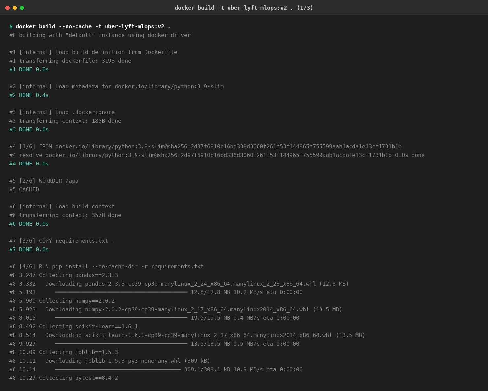
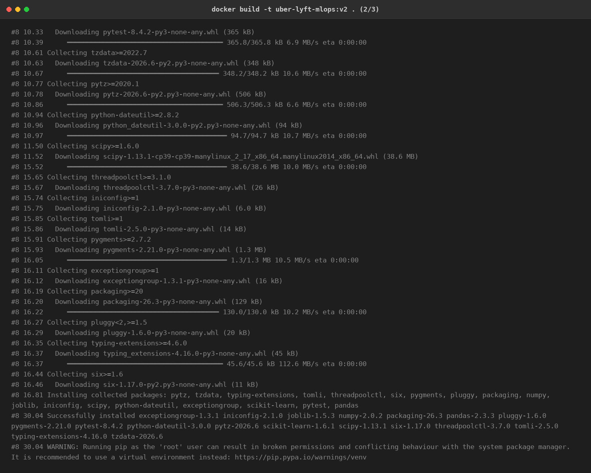
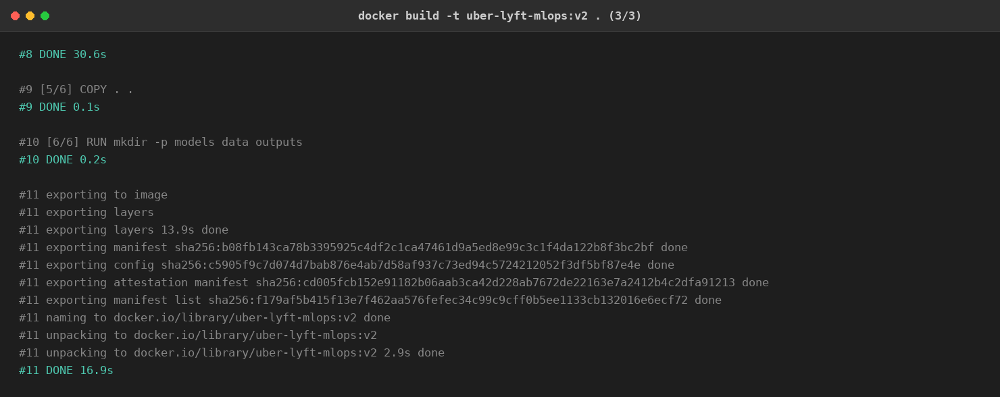
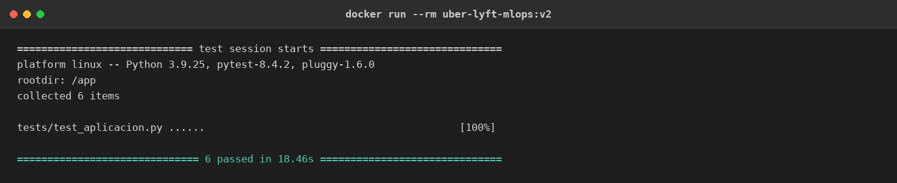
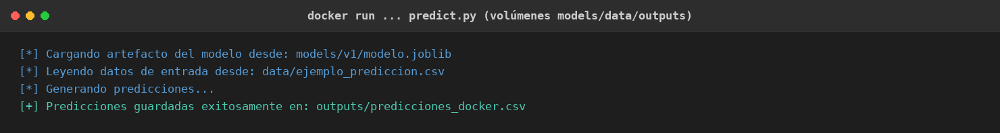
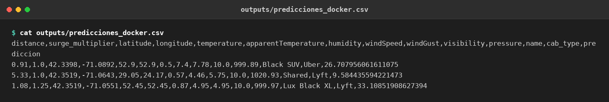
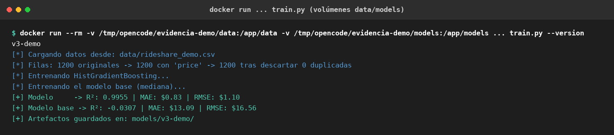
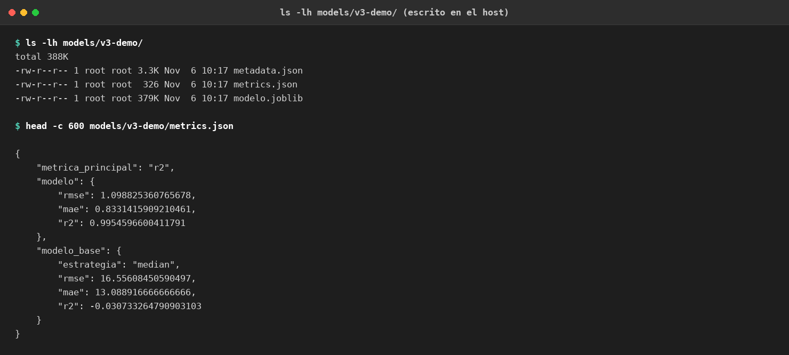

# Predicción de tarifas de Uber y Lyft en Boston

**Proyecto Integrador · Modelos y Simulación de Sistemas I · Universidad de Antioquia**

Integrantes: Alexandra Garavito Vargas, Juan Camilo Mona Luján y Dina Marcela
Reales Corredor.

Este repositorio contiene las dos primeras fases del proyecto y la evidencia de
ejecución del flujo de la Fase 2 dentro de Docker. El objetivo es predecir el
precio de una cotización de viaje de Uber o Lyft en Boston en el instante en que
el usuario la solicita.

| Aspecto | Definición |
|---|---|
| Tipo de problema | Regresión |
| Variable objetivo | `price` (dólares) |
| Algoritmo | `HistGradientBoostingRegressor` dentro de un `Pipeline` |
| Dataset | [Uber & Lyft Cab prices (Boston, MA)](https://www.kaggle.com/datasets/brllrb/uber-and-lyft-dataset-boston-ma) |
| Métrica principal | R² |
| Mejor resultado | R² 0,9622 · MAE $1,25 · RMSE $1,85 (v2) |

La Fase 1 construyó y evaluó el modelo en un notebook. La Fase 2 lo convirtió en
dos scripts ejecutables, `train.py` y `predict.py`, con versionamiento de
artefactos, pruebas automatizadas y una imagen Docker. Los documentos detallados
de cada fase están en [`fase-1/README.md`](fase-1/README.md) y
[`fase-2/README.md`](fase-2/README.md).

## Tabla de contenido

- [Problema y datos](#problema-y-datos)
- [Estructura del repositorio](#estructura-del-repositorio)
- [Fase 1: modelo en notebook](#fase-1-modelo-en-notebook)
- [Fase 2: aplicación reutilizable](#fase-2-aplicación-reutilizable)
- [Requisitos e instalación](#requisitos-e-instalación)
- [Ejecución local](#ejecución-local)
- [Ejecución con Docker](#ejecución-con-docker)
- [Evidencias de ejecución](#evidencias-de-ejecución)
- [Pruebas automatizadas](#pruebas-automatizadas)
- [Limitaciones conocidas](#limitaciones-conocidas)
- [Reproducibilidad](#reproducibilidad)

## Problema y datos

El dataset recoge **cotizaciones mostradas por la aplicación**, no transacciones
liquidadas. Por eso el resultado debe interpretarse como una estimación de
tarifa, no como el valor final pagado por un viaje.

El archivo original `rideshare_kaggle.csv` tiene 693.071 filas y 57 columnas,
pesa cerca de 350 MB y no se almacena en Git. Para obtenerlo:

1. Descarga `uber-and-lyft-dataset-boston-ma.zip` desde
   [Kaggle](https://www.kaggle.com/datasets/brllrb/uber-and-lyft-dataset-boston-ma).
2. Descomprímelo y deja `rideshare_kaggle.csv` en la raíz del repositorio, o en
   `fase-2/data/rideshare_kaggle.csv` si vas a entrenar con Docker.

El modelo usa 13 variables de entrada:

```
distance, surge_multiplier, latitude, longitude, temperature,
apparentTemperature, humidity, windSpeed, windGust, visibility, pressure,
name, cab_type
```

Antes de entrenar, `train.py` aplica este filtrado:

| Paso | Filas restantes |
|---|---|
| Archivo original | 693.071 |
| Sin las filas sin `price` (categoría Taxi) | 637.976 |
| Sin duplicados en las 13 variables de entrada más `price` | **549.313** |

La deduplicación se hace **solo sobre las columnas que el modelo usa**. Si se
hiciera sobre las 57 columnas, `id`, `timestamp` y `datetime` volverían única
cada fila y no se eliminaría ninguna; el resultado sería que observaciones
idénticas para el modelo cayeran a ambos lados de la partición y la evaluación
usara datos ya vistos durante el entrenamiento. El criterio estricto evita esa
fuga.

## Estructura del repositorio

```text
uber-lyft-price-predictor/
├── fase-1/
│   ├── fase_1_modelo.ipynb        # exploración, entrenamiento y evaluación
│   ├── README.md                  # detalle de la Fase 1
│   └── requirements.txt
├── fase-2/
│   ├── train.py                   # entrena y versiona el modelo
│   ├── predict.py                 # genera predicciones desde un CSV
│   ├── tests/
│   │   └── test_aplicacion.py     # 6 pruebas automatizadas con pytest
│   ├── models/
│   │   ├── v1/                    # modelo.joblib, metrics.json, metadata.json
│   │   └── v2/                    # modelo.joblib, metrics.json, metadata.json
│   ├── data/
│   │   └── ejemplo_prediccion.csv # 3 filas de ejemplo sin `price`
│   ├── Dockerfile
│   ├── .dockerignore
│   ├── requirements.txt
│   └── README.md                  # detalle de la Fase 2
├── modelos/
│   └── modelo_hgb_v1.joblib       # artefacto de la Fase 1
├── docs/
│   └── evidencias/                # capturas y logs de la ejecución en Docker
└── README.md
```

## Fase 1: modelo en notebook

El notebook [`fase-1/fase_1_modelo.ipynb`](fase-1/fase_1_modelo.ipynb) contiene la
exploración, la preparación de datos, la comparación de modelos mediante
validación cruzada de 5 pliegues y el entrenamiento final. El modelo elegido fue
un `Pipeline` con imputación por mediana, One-Hot Encoding y
`HistGradientBoostingRegressor`.

Resultados de la selección con validación cruzada sobre entrenamiento:

| Modelo | R² | MAE | RMSE |
|---|---|---|---|
| Dummy (mediana) | −0,0857 | $7,49 | $9,84 |
| Regresión lineal | 0,9254 | $1,82 | $2,58 |
| **HistGradientBoosting** | **0,9627** | **$1,22** | **$1,82** |

Evaluación final sobre el conjunto de prueba, usado una sola vez: **R² 0,9628,
MAE $1,22 y RMSE $1,81**. El modelo también se reentrenó con separaciones más
exigentes: temporal (R² 0,9626) y por rutas (R² 0,9524), lo que confirma que el
resultado no depende únicamente de la partición aleatoria.

## Fase 2: aplicación reutilizable

`train.py` recibe el CSV, la variable objetivo, el directorio de salida, la
versión y la semilla. Guarda `modelo.joblib`, `metrics.json` y `metadata.json` en
`models/<versión>/` y **rechaza sobrescribir una versión existente**. El
`metadata.json` registra la fecha, la semilla, las 13 columnas y sus tipos, los
parámetros del regresor, el preprocesamiento, las cifras del filtrado, la
partición, las versiones de Python y scikit-learn, y el commit con el que se
generaron los artefactos.

`predict.py` carga el artefacto, valida que el CSV tenga las columnas requeridas,
reordena las entradas según el esquema guardado y agrega la columna `prediccion`
sin perder las columnas adicionales. Las categorías desconocidas se codifican en
cero y los valores numéricos faltantes se imputan con la mediana aprendida.

Métricas de las dos versiones incluidas, evaluadas sobre la misma partición de
prueba:

| Versión | Semilla | Modelo R² | Modelo MAE | Base R² | Base MAE |
|---|---|---|---|---|---|
| v1 | 42 | 0,9617 | $1,25 | −0,0920 | $7,59 |
| v2 | 123 | **0,9622** | **$1,25** | −0,0919 | $7,57 |

El modelo base es `DummyRegressor(strategy="median")`. Su R² negativo indica que
es peor que predecir la media; el modelo reduce el MAE de aproximadamente $7,59 a
$1,25.

## Requisitos e instalación

Se usa **Python 3.9**, la misma versión de la imagen `python:3.9-slim`. Las
dependencias están fijadas en `fase-2/requirements.txt`:

```text
pandas==2.3.3
numpy==2.0.2
scikit-learn==1.6.1
joblib==1.5.3
pytest==8.4.2
```

La versión de scikit-learn debe coincidir con la de los artefactos guardados,
porque el modelo se serializa con `joblib`. Para trabajar sin Docker:

```bash
cd fase-2
python3 -m venv .venv
source .venv/bin/activate
python3 -m pip install -r requirements.txt
```

## Ejecución local

Entrenamiento con el dataset real:

```bash
cd fase-2
python3 train.py --data ../rideshare_kaggle.csv --target price \
  --output-dir models --version v1 --seed 42
```

Inferencia con el CSV de ejemplo:

```bash
cd fase-2
python3 predict.py --model models/v1/modelo.joblib \
  --input data/ejemplo_prediccion.csv \
  --output outputs/predicciones.csv
```

El CSV de salida conserva las columnas y el orden de las filas de entrada y
agrega `prediccion`. Si falta una columna requerida, el modelo no se puede leer o
la ruta de salida no es escribible, el script termina con código de error `1`.

## Ejecución con Docker

Las evidencias de este README se generaron con **Docker Engine 29.9.0** sobre
Linux. Los comandos son los mismos en Docker Desktop (Windows o macOS) una vez
iniciado el motor; en Windows conviene ejecutarlos desde WSL o adaptar la sintaxis
de los volúmenes.

### Construir la imagen

El `Dockerfile` está en `fase-2/`, así que el contexto de construcción debe ser
esa carpeta:

```bash
cd fase-2
docker build -t uber-lyft-mlops:v2 .
```

> Si ejecutas `docker build ... .` desde la raíz del repositorio, Docker no
> encontrará el `Dockerfile`. Primero entra a `fase-2/`.

La imagen parte de `python:3.9-slim`, instala las dependencias fijadas, copia el
código y define `python -m pytest` como comando por defecto. El `.dockerignore`
excluye datasets, modelos, salidas locales, entornos virtuales y cachés; el CSV
de ejemplo sí se incluye. La imagen final pesa alrededor de 660 MB.

### Ejecutar las pruebas dentro del contenedor

```bash
docker run --rm uber-lyft-mlops:v2
```

### Generar predicciones montando volúmenes

Se montan `models/`, `data/` y `outputs/` para leer el artefacto y el CSV de
entrada desde el host, y para conservar el resultado fuera del contenedor:

```bash
cd fase-2
docker run --rm \
  -v "$(pwd)/models:/app/models" \
  -v "$(pwd)/data:/app/data" \
  -v "$(pwd)/outputs:/app/outputs" \
  uber-lyft-mlops:v2 \
  python predict.py --model models/v1/modelo.joblib \
    --input data/ejemplo_prediccion.csv \
    --output outputs/predicciones_docker.csv
```

### Entrenar montando volúmenes

Con el dataset real en `fase-2/data/rideshare_kaggle.csv`, usa una versión nueva
(`v3`, por ejemplo), porque `v1` y `v2` ya existen y `train.py` no las
sobrescribe:

```bash
cd fase-2
docker run --rm \
  -v "$(pwd)/data:/app/data" \
  -v "$(pwd)/models:/app/models" \
  uber-lyft-mlops:v2 \
  python train.py --data data/rideshare_kaggle.csv --target price \
    --output-dir models --version v3 --seed 42
```

Los artefactos de `v3` quedan en el `models/` del host gracias al volumen.

## Evidencias de ejecución

Los logs completos están en [`docs/evidencias/`](docs/evidencias/) y las capturas
son renderizaciones de esas mismas salidas de terminal, no capturas de una sesión
gráfica. El repositorio se actualizó con `git pull origin develop` antes de
ejecutar las pruebas; el HEAD usado fue `a7223c2`.

### 1. Construcción de la imagen

```bash
cd fase-2
docker build --no-cache -t uber-lyft-mlops:v2 .
```







Las capturas muestran una construcción completa sin caché: descarga de la imagen
base, instalación de las dependencias fijadas, copia del proyecto y exportación
de `uber-lyft-mlops:v2`. La construcción terminó sin errores.

### 2. Pruebas automatizadas dentro del contenedor

```bash
docker run --rm uber-lyft-mlops:v2
```



Resultado: **6 pruebas superadas** en 18,46 s. Las pruebas cubren el
entrenamiento y almacenamiento, la carga y predicción conservando las filas, la
imputación de valores faltantes, el rechazo de entradas inválidas, el
versionamiento sin sobrescritura y la deduplicación antes de particionar.

### 3. Inferencia con volúmenes

```bash
docker run --rm \
  -v "$(pwd)/models:/app/models" \
  -v "$(pwd)/data:/app/data" \
  -v "$(pwd)/outputs:/app/outputs" \
  uber-lyft-mlops:v2 \
  python predict.py --model models/v1/modelo.joblib \
    --input data/ejemplo_prediccion.csv \
    --output outputs/predicciones_docker.csv
```



El contenedor leyó el modelo `v1` y el CSV de ejemplo desde el host, y escribió
el resultado en `fase-2/outputs/predicciones_docker.csv`:



| `name` | `cab_type` | `distance` | `surge_multiplier` | Predicción |
|---|---|---|---|---|
| Black SUV | Uber | 0,91 | 1,00 | $26,71 |
| Shared | Lyft | 5,33 | 1,00 | $9,58 |
| Lux Black XL | Lyft | 1,08 | 1,25 | $33,11 |

La tercera fila ilustra el efecto del `surge_multiplier`: un recorrido corto con
recargo de 1,25 produce una tarifa alta por el tipo de servicio.

### 4. Entrenamiento con volúmenes

Como el dataset real de 350 MB no se versiona, para probar el montaje de
volúmenes de entrenamiento se generó un **dataset sintético de demostración** de
1.200 filas con las mismas 14 columnas (13 entradas más `price`). No pretende
reemplazar las métricas reales de `v1` y `v2`; solo verifica que el contenedor
escribe los artefactos en el host.

```bash
docker run --rm \
  -v /ruta/al/dataset:/app/data \
  -v /ruta/a/modelos:/app/models \
  uber-lyft-mlops:v2 \
  python train.py --data data/rideshare_demo.csv --target price \
    --output-dir models --version v3-demo --seed 42
```



El entrenamiento de demostración obtuvo R² 0,9955 y MAE $0,83. Al terminar, los
tres artefactos aparecieron en el directorio del host montado en `/app/models`:



Para reproducir el flujo con datos reales, reemplaza `rideshare_demo.csv` por
`rideshare_kaggle.csv` y usa una versión nueva, como se indica en la sección de
Docker.

## Pruebas automatizadas

Desde `fase-2/`:

```bash
python3 -m pytest
```

Las 6 pruebas usan datos sintéticos y un directorio temporal, de modo que no
necesitan el dataset de Kaggle ni modifican los artefactos versionados.

## Limitaciones conocidas

- **`surge_multiplier` puede no estar disponible al cotizar.** Es una de las 13
  entradas y correlaciona 0,24 con el precio. Si en producción solo se conoce al
  confirmar el viaje, sería información posterior al evento y habría que
  retirarla del esquema o reentrenar sin ella antes de exponer una API.
- **El poder predictivo proviene en buena parte del tarifario.** Con las
  variables numéricas solas el R² ronda 0,18; el salto a 0,96 lo produce `name`,
  el tipo de servicio. El modelo aprende la tabla de tarifas más que la dinámica
  del precio.
- **Se conservan pares correlacionados** (`temperature`/`apparentTemperature` y
  `windSpeed`/`windGust`) de forma intencional. Un modelo de árboles no se ve
  afectado por esa redundancia.
- **Las predicciones son cotizaciones, no precios pagados.**
- **No hay valores faltantes en las variables predictoras.** Los 55.095 nulos del
  dataset están en `price`, la variable objetivo.
- **La cobertura es limitada:** Boston, 72 rutas y del 26 de noviembre al 18 de
  diciembre de 2018. No representa estacionalidad anual ni otras ciudades.

## Reproducibilidad

- Los artefactos `v1` y `v2` se generaron con semillas 42 y 123,
  respectivamente, y scikit-learn 1.6.1.
- Cada `metadata.json` guarda el commit HEAD del momento de entrenar, la rama, el
  estado del árbol y las cifras exactas del filtrado.
- Los artefactos se confirman en un commit posterior al que los generó, por lo
  que el hash de `metadata.json` identifica el código utilizado, no el commit que
  los almacena.
- Las pruebas, la inferencia y el entrenamiento de demostración de este README se
  ejecutaron dentro de la imagen `uber-lyft-mlops:v2`; los logs y capturas están
  en `docs/evidencias/`.
